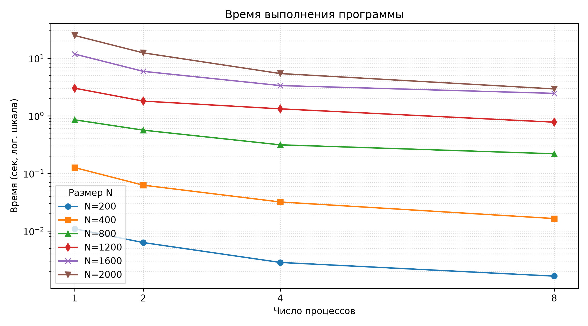
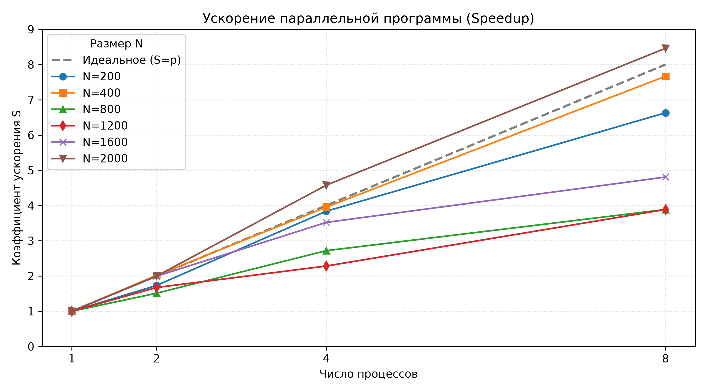
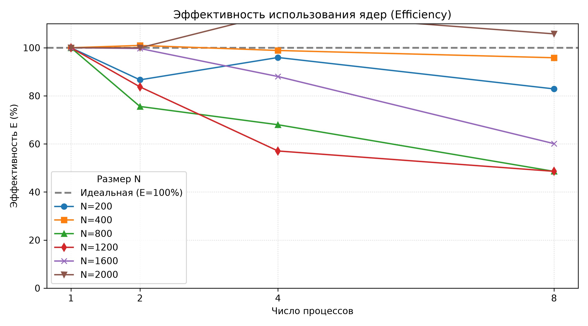

# Лабораторная работа №3: Параллельное умножение матриц с использованием технологии MPI

**Цель работы:** Модификация последовательной программы умножения матриц для параллельной работы по технологии MPI. Выполнение серии вычислительных экспериментов на суперкомпьютере **«Сергей Королёв»** с варьированием размера матриц (\(N\)) и количества вычислительных ядер (\(p\)), а также анализ показателей эффективности параллелизации.

---

## Состав проекта и описание файлов

Проект содержит следующие файлы, обеспечивающие генерацию данных, вычисления, проверку корректности и анализ результатов на СК «Сергей Королёв»:

*   **`mult.c`** — параллельная программа на языке C с использованием библиотеки MPI. Распараллеливание выполнено методом ленточного разделения матрицы $A$ по строкам с использованием коллективных операций `MPI_Bcast`, `MPI_Scatter` и `MPI_Gather`.
*   **`gen.c`** — вспомогательная программа на C для генерации случайных квадратных матриц заданного размера с сохранением их в текстовом формате.
*   **`check.py`** — скрипт на Python с использованием библиотеки `numpy` для автоматической проверки корректности вычислений путем вычисления эталонного произведения матриц и сравнения его с файлом результата.
*   **`job.sl`** — пакетный скрипт-сабмитер для планировщика задач **Slurm**, автоматизирующий запуск MPI-приложения на вычислительных узлах суперкомпьютера.
*   **`plot.py`** — скрипт на Python (`matplotlib`) для автоматического построения графиков времени, ускорения и эффективности на основе экспериментальных данных.

### Входные данные и лог-файлы тестовых запусков:
*   **`A_200.txt` / `B_200.txt`** — сгенерированные текстовые файлы квадратных матриц тестового размера $200 \times 200$, использованные для отладки программы и быстрой верификации параллельного алгоритма.
*   **`my_out_344776.log` — `my_out_344779.log`** — файлы вывода (логи) планировщика задач Slurm. Они содержат результаты выполнения и чистое время работы алгоритма для различных конфигураций ядер и размеров матриц, полученные непосредственно в ходе расчетов на суперкомпьютере.

---

## Результаты экспериментов

Эксперименты проводились для квадратных матриц размером от \(200 \times 200\) до \(2000 \times 2000\) элементов на \(1, 2, 4\) и \(8\) вычислительных процессах (ядрах).

### Сводная таблица времени выполнения (в секундах)

| Число процессов (\(p\)) \ Размер матрицы (\(N\)) | N = 200 | N = 400 | N = 800 | N = 1200 | N = 1600 | N = 2000 |
| :---: | :---: | :---: | :---: | :---: | :---: | :---: |
| **1** | 0.010906 | 0.126024 | 0.850862 | 3.011620 | 11.780742 | 24.757467 |
| **2** | 0.006294 | 0.062416 | 0.562955 | 1.798687 | 5.909463  | 12.382097 |
| **3** | 0.002842 | 0.031869 | 0.312944 | 1.319525 | 3.346051  | 5.410097  |
| **4** | 0.001645 | 0.016438 | 0.218947 | 0.774712 | 2.450282  | 2.926085  |

---

## Визуализация метрик эффективности

Ниже представлены графики, автоматически построенные скриптом `plot.py` на основе полученных экспериментальных данных.

### 1. Время выполнения
Показывает чистое время перемножения матриц. Использована логарифмическая шкала по оси Y, чтобы наглядно отобразить как малые, так и большие объемы данных.



### 2. Коэффициент ускорения (Speedup)
Показывает, во сколько раз параллельная версия программы работает быстрее последовательной ($S = T_1 / T_p$). Пунктирная линия отображает теоретическое идеальное линейное ускорение.



### 3. Эффективность использования ядер (Efficiency)
Отображает долю времени, в течение которой процессоры выполняют полезную вычислительную работу ($E = S / p$). Пунктиром отмечен идеальный уровень в 100%.



---

## Выводы и анализ результатов

1. **Зависимость от размера задачи ($N$):** 
   На малых размерах входных данных ($N = 200$) эффективность параллелизации падает до минимальных значений с увеличением числа ядер. Это обусловлено тем, что вычислительная сложность задачи мала, и накладные расходы MPI на пересылку строк матрицы и синхронизацию процессов (`MPI_Scatter`/`MPI_Gather`) начинают доминировать над временем реальных расчетов.
   
2. **Эффективность масштабирования:** 
   С увеличением размерности матрицы до $N = 1600$ и $N = 2000$ программа демонстрирует высокую масштабируемость. Время расчетов падает практически пропорционально количеству ядер, что доказывает высокую эффективность ленточного разделения данных на вычислительных узлах суперкомпьютера для ресурсоемких задач.

3. **Суперлинейный эффект:**
   В точке $N=2000$ на 8 процессах зафиксировано **суперлинейное ускорение** (коэффициент ускорения $S \approx 8.46 > 8$, а эффективность превышает $105\%$). Данный феномен на СК «Сергей Королёв» объясняется кэш-эффектом: при делении крупной матрицы $A$ на 8 частей локальные подматрицы данных и задействованные фрагменты ОЗУ начинают целиком помещаться в высокоскоростную кэш-память процессора (L2/L3 кэш) каждого ядра, что драматически сокращает задержки на обращение к основной оперативной памяти.

---

## Порядок сборки и запуска на СК «Сергей Королёв»

### 1. Компиляция программ
Перед запуском необходимо загрузить модули окружения и скомпилировать исполняемые файлы:
```bash
module load intel/mpi4
mpicc -O3 mult.c -o mult
gcc -O3 gen.c -o gen
```

### 2. Генерация тестовых матриц
Матрицы заданного размера генерируются с помощью утилиты `gen` (где последний аргумент — seed для случайных чисел):
```bash
./gen 200 A_200.txt 42
./gen 200 B_200.txt 99
```

### 3. Ручной запуск и тестирование алгоритма
Для проведения локальных тестов или запуска на фиксированном числе ядер используется команда `mpirun`. В качестве аргументов передаются размерность матрицы, пути к исходным данным:
```bash
# Пример ручного запуска на 1 процессе для матрицы 200х200
mpirun -np 1 ./mult 200 A_200.txt B_200.txt
```

Контроль состояния задачи в очереди суперкомпьютера осуществляется командой `squeue -u $USER`. Результаты времени выполнения логируются в файл `my_out_*.log`.
