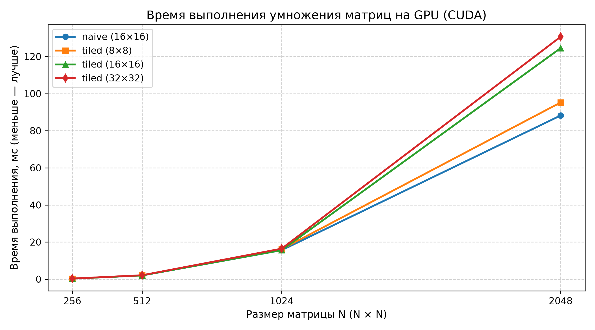
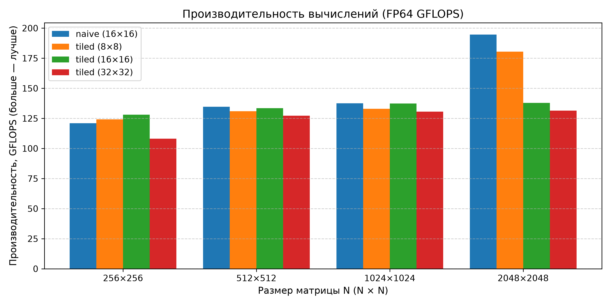

# Лабораторная работа №4 — Распараллеливание алгоритма умножения матриц по технологии CUDA

В проекте реализованы и сравнены два вычислительных ядра (CUDA kernels):

1. **Наивная реализация (`naive`)** — каждый поток вычисляет один элемент результирующей матрицы $C[i][j]$, напрямую обращаясь к глобальной памяти видеокарты (Global Memory).
2. **Тайловая реализация (`tiled`)** — использует быструю разделяемую память мультипроцессора (`__shared__ memory`) для блочного перемножения матриц (Shared Memory Tiling), что снижает количество обращений к глобальной памяти. Поддерживаются размеры тайлов `8×8`, `16×16` и `32×32`.

## Структура репозитория

* `lab4_cuda.cu` — исходный код программы на C/CUDA (загрузка матриц, выделение памяти на GPU, запуск ядер, замер времени через `cudaEvent_t`, сохранение результатов).
* `gen.py` — генератор входных матриц `matrixA.txt` и `matrixB.txt` заданного размера $N \times N$.
* `verify.py` — скрипт автоматической верификации результатов вычислений GPU с эталонным произведением через библиотеку `NumPy`.
* `run.bat` — пакетный скрипт для автоматического проведения серии экспериментов на различных размерностях матриц и конфигурациях сетки блоков.
* `plot_results.py` — скрипт для построения графиков времени выполнения и производительности (GFLOPS).
* `results_all.txt` — полный лог прогона всех 16 экспериментов с проверкой корректности.

## Результаты экспериментов

Время выполнения вычислительного ядра (в миллисекундах) для матриц размером от $256 \times 256$ до $2048 \times 2048$:

| Размер матрицы ($N \times N$) | `naive` ($16 \times 16$) | `tiled` ($8 \times 8$) | `tiled` ($16 \times 16$) | `tiled` ($32 \times 32$) |
| :--- | :---: | :---: | :---: | :---: |
| **256 × 256** | 0.2775 мс | 0.2702 мс | **0.2621 мс** | 0.3103 мс |
| **512 × 512** | **1.9937 мс** | 2.0511 мс | 2.0122 мс | 2.1105 мс |
| **1024 × 1024** | **15.6088 мс** | 16.1536 мс | 15.6314 мс | 16.4444 мс |
| **2048 × 2048** | **88.2268 мс** | 95.2433 мс | 124.5471 мс | 130.6665 мс |

## Графики производительности

### Время выполнения вычислительных ядер


### Вычислительная производительность (FP64 GFLOPS)


## Выводы по результатам и графикам

1. **Масштабируемость времени выполнения (График 1):**
   * Кривые времени имеют кубический характер роста ($O(N^3)$): при увеличении размерности матрицы $N$ в 2 раза объем вычислений растет в 8 раз, а время выполнения увеличивается примерно в 7.5–8 раз (с ~0.27 мс для $256 \times 256$ до ~88–130 мс для $2048 \times 2048$).
   * На матрицах малого и среднего размера ($256 \dots 1024$) все четыре конфигурации показывают близкие результаты, но при переходе к размеру $2048 \times 2048$ кривые заметно расходятся.

2. **Рост реальной производительности и насыщение GPU (График 2):**
   * По столбчатой диаграмме GFLOPS видно, что с ростом размера задачи утилизация вычислительных блоков видеокарты увеличивается: производительность возрастает примерно в **1.5 раза** при переходе от $256 \times 256$ (~120–128 GFLOPS) к $2048 \times 2048$ (до **~195 GFLOPS** у ядра `naive`).
   * На малых матрицах ($256 \times 256$) создается недостаточно блоков потоков, чтобы полностью загрузить все потоковые мультипроцессоры (SM) видеокарты, из-за чего пиковая производительность не достигается.

3. **Влияние размера блока потоков (`8×8`, `16×16`, `32×32`):**
   * Среди тайловых конфигураций наилучший баланс обеспечивает блок **16 × 16** (256 потоков) — на матрицах до $1024 \times 1024$ он стабильно опережает варианты `8×8` и `32×32`.
   * Блок **32 × 32** (1024 потока) во всех экспериментах оказался самым медленным: для хранения двух тайлов типа `double` требуется 16 КБ разделяемой памяти на блок, что ограничивает количество одновременно активных блоков на мультипроцессоре (снижает *occupancy*) и увеличивает задержки на барьерной синхронизации `__syncthreads()`.

4. **Сравнение `naive` и `tiled` для чисел двойной точности (`double`):**
   * На крупных матрицах ($2048 \times 2048$) наивная реализация с блоком `16×16` показала максимальную производительность (~195 GFLOPS против ~130–180 GFLOPS у тайловых версий).
   * Это связано с тем, что современные GPU обладают емким кэшем L1/L2, который эффективно сглаживает чтение строк и столбцов, тогда как тайловое ядро при работе с 8-байтным типом `double` сталкивается с конфликтами банков разделяемой памяти (shared memory bank conflicts) и дополнительными затратами на синхронизацию потоков.


## Сборка и запуск

1. Откройте консоль **x64 Native Tools Command Prompt for VS** и перейдите в директорию проекта:
   ```cmd
   cd путь\к\проекту
   ```

2. Скомпилируйте программу с помощью `nvcc` (флаг `-arch=native` оптимизирует сборку под архитектуру установленной видеокарты):
   ```cmd
   nvcc -O3 -arch=native lab4_cuda.cu -o lab4_cuda.exe
   ```

3. Запустите одиночный тест вручную:
   ```cmd
   lab4_cuda.exe [naive|tiled] [blockDimX] [blockDimY]
   ```
   Пример:
   ```cmd
   lab4_cuda.exe tiled 16 16
   ```

4. Или запустите полную серию экспериментов с сохранением лога:
   ```cmd
   run.bat > results_all.txt 2>&1
   ```

5. Постройте графики по результатам измерений:
   ```cmd
   py plot_results.py
   ```
